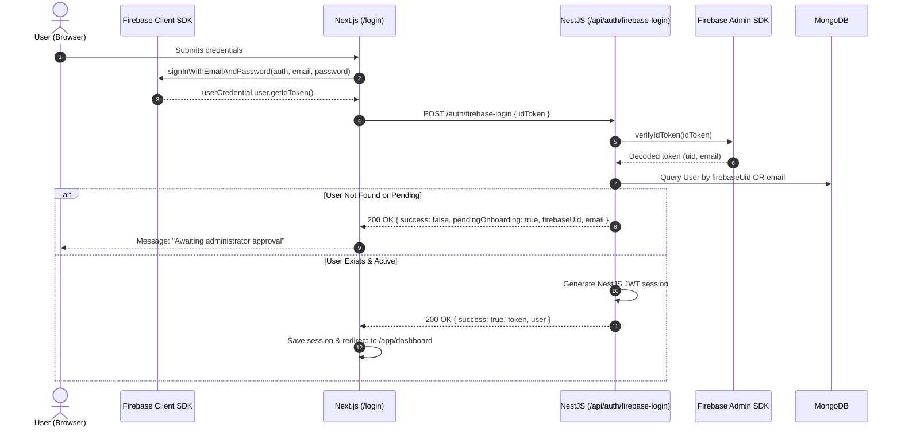

# SafeVitals XR CRM — Authentication & Authorization Flows

> **Protocol Standards**: JSON Web Token (JWT) Bearer, RFC 6238 (Time-based/Dispatched One-Time Passwords), Firebase Auth Token Federation, PBKDF2/Bcrypt password hashing (salt rounds: 12).

---

## 1. Flow Diagrams & Sequence Mechanics

---

### Flow 1: Standard Email & Password with Two-Factor OTP Verification

```mermaid
sequenceDiagram
    autonumber
    actor User as User (Browser)
    participant UI as Next.js (/login & /verify-otp)
    participant API as NestJS (/api/auth)
    participant DB as MongoDB (users)
    participant Mail as Mailer / SES

    User->>UI: Inputs email & password
    UI->>API: POST /auth/login { email, password }
    API->>DB: Query user by lowercase email (select: +passwordHash)
    Note over API: Compare password via bcrypt
    alt Credentials Invalid
        API-->>UI: 401 Unauthorized ("Invalid email or password.")
        UI-->>User: Displays error message
    else Account Suspended
        API-->>UI: 403 Forbidden ("Account suspended.")
    else Credentials Valid (2FA Required)
        API->>API: Generate 6-digit cryptographic OTP & hash it
        API->>DB: Save otpCodeHash, otpExpiresAt (5 min), otpAttempts = 0
        API->>Mail: Dispatch email containing 6-digit code
        API-->>UI: 200 OK { success: true, userId, message: "OTP sent to your email!" }
        UI->>UI: setPendingAuth(userId, email)
        UI-->>User: Redirect to /verify-otp
    end

    User->>UI: Enters 6-digit code on /verify-otp
    UI->>API: POST /auth/verify-otp { userId, otp }
    API->>DB: Query user with select: +otpCodeHash +otpExpiresAt
    alt OTP Expired or Attempts Exceeded
        API-->>UI: 400 Bad Request ("Code expired or max attempts exceeded.")
    else OTP Invalid
        API->>DB: Increment otpAttempts
        API-->>UI: 400 Bad Request ("Invalid code.")
    else OTP Matches
        API->>DB: Clear OTP fields; update lastLoginAt
        API->>API: Sign JWT with { sub: user.id, email, role: role.name, permissions }
        API-->>UI: 200 OK { success: true, token, user, mustChangePassword }
        UI->>UI: Save to localStorage ("safevitals-auth-storage")
        alt mustChangePassword == true
            UI-->>User: Redirect to /change-password
        else Normal User
            UI-->>User: Redirect to /app/dashboard
        end
    end
```

---

### Flow 2: Firebase Federated Authentication

Used for Super Admins and clients authenticating via Google / Firebase SDK directly:



---

### Flow 3: Candidate Self-Registration & Admin Approval Flow

```mermaid
sequenceDiagram
    autonumber
    actor Candidate as Candidate
    participant RegUI as Next.js (/register)
    participant OTPUI as Next.js (/register/verify-otp)
    participant API as NestJS (/api/auth & /api/users)
    participant Mail as Mail Service
    participant AdminUI as Super Admin (/app/registration-requests)
    participant DB as MongoDB

    Candidate->>RegUI: Fills Full Name, Email, Phone
    RegUI->>API: POST /auth/register { fullName, email, phone }
    API->>API: Check email uniqueness; Generate registrationToken & 6-digit OTP
    API->>Mail: Send verification email with 6-digit OTP
    API-->>RegUI: 200 OK { success: true, registrationToken }
    RegUI->>RegUI: Store registrationToken in sessionStorage
    RegUI-->>Candidate: Redirect to /register/verify-otp

    Candidate->>OTPUI: Submits 6-digit code + initial password
    OTPUI->>API: POST /auth/register/verify-otp { registrationToken, otp, password }
    API->>API: Validate OTP & hash password
    API->>DB: Create User record with status = "Pending"
    API-->>OTPUI: 200 OK { success: true, pendingOnboarding: true }
    OTPUI-->>Candidate: Shows "Registration Complete! Pending Admin Approval"

    Note over AdminUI,API: Admin logs in to Command Center
    AdminUI->>API: GET /users/pending
    API->>DB: Query users where status == "Pending"
    API-->>AdminUI: 200 OK [ pendingUsers ]

    AdminUI->>API: POST /users/:userId/approve { departmentId, teamId, positionId, roleId }
    API->>API: Generate sequential employeeId ("EMP-000105")
    API->>DB: Create Employee record linked to User; Update User.status = "Active"
    API->>Mail: Send approval notification email to Candidate
    API-->>AdminUI: 200 OK { success: true, message: "User approved" }
```

---

### Flow 4: Employee Invitation & Account Activation Flow

```mermaid
sequenceDiagram
    autonumber
    actor Admin as Admin / HR
    participant AdminUI as Next.js (/app/employees)
    participant InviteUI as Next.js (/activate-account)
    participant API as NestJS (/api/employees & /api/auth)
    participant Mail as Mail Service
    participant DB as MongoDB
    actor Employee as New Employee

    Admin->>AdminUI: Opens InviteEmployeeModal
    AdminUI->>API: POST /employees { firstName, lastName, email, departmentId, teamId, positionId, roleId }
    API->>API: Generate sequential employeeId ("EMP-000045")
    API->>API: Generate random cryptographically secure invitationToken
    API->>DB: Create User (status: "Pending") + Employee record
    API->>DB: Save Invitation { email, employeeId, token, expiresAt: 7 days }
    API->>Mail: Send invitation link with token (/activate-account?token=...&email=...)
    API-->>AdminUI: 201 Created { success: true, employee }

    Employee->>InviteUI: Clicks email link to /activate-account?token=XYZ&email=...
    Employee->>InviteUI: Enters strong permanent password
    InviteUI->>API: POST /auth/setup-password { invitationToken: XYZ, password }
    API->>DB: Find Invitation by token (check expiry & status)
    API->>DB: Hash password on User; Set User.status = "Active"; Mark Invitation = "Activated"
    API-->>InviteUI: 200 OK { success: true }
    InviteUI-->>Employee: Redirect to /login
```

---

### Flow 5: Password Recovery Flow

```mermaid
sequenceDiagram
    autonumber
    actor User as User
    participant ForgotUI as Next.js (/forgot-password)
    participant ResetUI as Next.js (/reset-password)
    participant API as NestJS (/api/auth)
    participant Mail as Mailer
    participant DB as MongoDB

    User->>ForgotUI: Enters email
    ForgotUI->>API: POST /auth/forgot-password { email }
    API->>DB: Find user by email
    alt User exists
        API->>API: Generate reset token & expiry (15 mins)
        API->>DB: Save resetPasswordTokenHash
        API->>Mail: Send password reset email with token
    end
    API-->>ForgotUI: 200 OK { success: true } (Always 200 to prevent user enumeration)

    User->>ResetUI: Submits reset token + new password
    ResetUI->>API: POST /auth/reset-password { token, password }
    API->>DB: Validate token & expiry
    API->>DB: Hash new password; Clear reset token fields
    API-->>ResetUI: 200 OK { success: true }
    ResetUI-->>User: Redirect to /login
```

---

## 2. JWT Token Payload & Security Design

### 2.1 Token Payload Schema
```json
{
  "sub": "660c1f2e4b8d9a0012f34567",
  "email": "employee@safevitals.com",
  "role": "Super Admin",
  "roleId": "role_1",
  "employeeId": "EMP-000001",
  "employeeDocId": "660c1f2e4b8d9a0012f34568",
  "departmentId": "660c1f2e4b8d9a0012f34569",
  "teamId": "660c1f2e4b8d9a0012f3456a",
  "isSuperAdmin": true,
  "permissions": [
    "*.*.*"
  ],
  "iat": 1776077100,
  "exp": 1776163500
}
```

### 2.2 Security Guidelines
- **Expiration**: Access token valid for 24 hours (or configurable via `JWT_EXPIRES_IN`).
- **Algorithm**: `HS256` (HMAC with SHA-256) via server-side secret key `JWT_SECRET`.
- **Revocation**: Upon user suspension or deactivation (`/employees/:id/suspend`), token is invalidated or checked against user status during Guard validation.

---

## 3. NestJS Authentication Architecture

1. **`JwtStrategy` (`@nestjs/passport`)**:
   - Extracts Bearer token from header: `ExtractJwt.fromAuthHeaderAsBearerToken()`.
   - Validates payload and verifies the user is still `Active` in the database.
2. **`JwtAuthGuard`**:
   - Applied globally via `APP_GUARD` or explicitly on controllers.
   - Bypassed for routes decorated with `@Public()`.
3. **`RolesGuard` / `PermissionsGuard`**:
   - Compares required permission decorators (`@RequirePermission('employees.create')`) against the user's `permissions` array or role.
