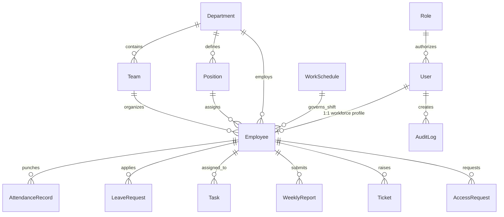

# SafeVitals XR CRM — MongoDB Database Schema & Architecture

> **Database Engine**: MongoDB 7.x  
> **ODM**: Mongoose 8.x with TypeScript  
> **Global Conventions**: All collections use lowercase plural names with standard MongoDB ObjectIds (`_id`). All schemas declare `timestamps: true` (`createdAt`, `updatedAt`) and enable virtual `id` (`toJSON: { virtuals: true }, toObject: { virtuals: true }`).

---

## 1. Entity-Relationship Overview



---

## 2. Detailed Collection Schemas

---

### 2.1 `users` Collection
Stores authentication credentials, security status, two-factor OTP secrets, and system role mappings.

```ts
import { Prop, Schema, SchemaFactory } from '@nestjs/mongoose';
import { Document, Types } from 'mongoose';

export type UserStatus = 'Pending' | 'Active' | 'Suspended' | 'Deactivated';

@Schema({ timestamps: true, collection: 'users' })
export class User extends Document {
  @Prop({ required: true, unique: true, lowercase: true, trim: true, index: true })
  email: string;

  @Prop({ required: false, select: false }) // Excluded by default in queries
  passwordHash?: string;

  @Prop({ required: true, trim: true })
  firstName: string;

  @Prop({ required: true, trim: true })
  lastName: string;

  @Prop({ trim: true })
  fullName?: string;

  @Prop({ trim: true })
  phone?: string;

  @Prop({ type: String, unique: true, sparse: true, index: true })
  firebaseUid?: string;

  @Prop({ type: String, enum: ['Pending', 'Active', 'Suspended', 'Deactivated'], default: 'Pending', index: true })
  status: UserStatus;

  @Prop({ type: Types.ObjectId, ref: 'Role', required: true, index: true })
  roleId: Types.ObjectId;

  @Prop({ type: Types.ObjectId, ref: 'Employee' })
  employeeDocId?: Types.ObjectId;

  @Prop({ default: false })
  isSuperAdmin: boolean;

  @Prop({ default: false })
  mustChangePassword: boolean;

  @Prop({ default: true })
  twoFactorEnabled: boolean;

  // Ephemeral 2FA OTP State
  @Prop({ type: String, select: false })
  otpCodeHash?: string;

  @Prop({ type: Date, select: false })
  otpExpiresAt?: Date;

  @Prop({ type: Number, default: 0, select: false })
  otpAttempts?: number;

  // Password Recovery
  @Prop({ type: String, select: false })
  resetPasswordTokenHash?: string;

  @Prop({ type: Date, select: false })
  resetPasswordExpiresAt?: Date;

  @Prop()
  avatarUrl?: string;

  @Prop({ type: Date })
  lastLoginAt?: Date;
}

export const UserSchema = SchemaFactory.createForClass(User);
UserSchema.index({ email: 1 }, { unique: true });
UserSchema.index({ firebaseUid: 1 }, { unique: true, sparse: true });
```

---

### 2.2 `employees` Collection
Primary workforce domain model with sequential company ID, organizational bindings, and personal contact details.

```ts
import { Prop, Schema, SchemaFactory } from '@nestjs/mongoose';
import { Document, Types } from 'mongoose';

@Schema({ timestamps: true, collection: 'employees' })
export class Employee extends Document {
  @Prop({ required: true, unique: true, uppercase: true, index: true })
  employeeId: string; // e.g. "EMP-000001"

  @Prop({ type: Types.ObjectId, ref: 'User', required: true, unique: true, index: true })
  userId: Types.ObjectId;

  @Prop({ required: true, trim: true })
  firstName: string;

  @Prop({ required: true, trim: true })
  lastName: string;

  @Prop({ required: true, lowercase: true, trim: true, index: true })
  email: string;

  @Prop({ lowercase: true, trim: true })
  secondaryEmail?: string;

  @Prop({ trim: true })
  phone?: string;

  @Prop({ trim: true })
  address?: string;

  @Prop({ type: Types.ObjectId, ref: 'Department', required: false, index: true })
  departmentId?: Types.ObjectId;

  @Prop({ type: Types.ObjectId, ref: 'Team', required: false, index: true })
  teamId?: Types.ObjectId;

  @Prop({ type: Types.ObjectId, ref: 'Position', required: false, index: true })
  positionId?: Types.ObjectId;

  @Prop({ trim: true })
  position?: string; // Cache of position title for rapid grid rendering

  @Prop({ type: Types.ObjectId, ref: 'Role', required: true, index: true })
  roleId: Types.ObjectId;

  @Prop({ type: Types.ObjectId, ref: 'Employee', default: null })
  managerId?: Types.ObjectId;

  @Prop({ type: Types.ObjectId, ref: 'WorkSchedule', default: null })
  workScheduleId?: Types.ObjectId;

  @Prop({ type: String, enum: ['Active', 'Suspended', 'Deactivated'], default: 'Active', index: true })
  status: string;

  @Prop({ type: String, default: () => new Date().toISOString().split('T')[0] })
  joiningDate: string; // YYYY-MM-DD

  @Prop({ trim: true })
  avatarUrl?: string;
}

export const EmployeeSchema = SchemaFactory.createForClass(Employee);
EmployeeSchema.index({ employeeId: 1 }, { unique: true });
EmployeeSchema.index({ userId: 1 }, { unique: true });
EmployeeSchema.index({ departmentId: 1, teamId: 1 });
```

---

### 2.3 `departments` Collection
Core organizational divisions.

```ts
@Schema({ timestamps: true, collection: 'departments' })
export class Department extends Document {
  @Prop({ required: true, unique: true, trim: true })
  name: string; // e.g. "XR Engineering & R&D"

  @Prop({ trim: true })
  description?: string;

  @Prop({ type: Types.ObjectId, ref: 'Employee', default: null })
  managerId?: Types.ObjectId; // Department Head

  @Prop({ default: false })
  isArchived: boolean;
}

export const DepartmentSchema = SchemaFactory.createForClass(Department);
```

---

### 2.4 `teams` Collection
Cross-functional squads within departments.

```ts
@Schema({ timestamps: true, collection: 'teams' })
export class Team extends Document {
  @Prop({ required: true, trim: true })
  name: string; // e.g. "Optical Sensors & IMU"

  @Prop({ type: Types.ObjectId, ref: 'Department', required: true, index: true })
  departmentId: Types.ObjectId;

  @Prop({ type: Types.ObjectId, ref: 'Employee', default: null })
  leadId?: Types.ObjectId;

  @Prop({ default: false })
  isArchived: boolean;
}

export const TeamSchema = SchemaFactory.createForClass(Team);
TeamSchema.index({ departmentId: 1, name: 1 }, { unique: true });
```

---

### 2.5 `positions` Collection
Hierarchical job positions and seniority levels.

```ts
@Schema({ timestamps: true, collection: 'positions' })
export class Position extends Document {
  @Prop({ required: true, trim: true })
  name: string; // e.g. "Senior Spatial Firmware Engineer"

  @Prop({ type: Types.ObjectId, ref: 'Department', required: true, index: true })
  departmentId: Types.ObjectId;

  @Prop({ 
    type: String, 
    enum: ['Intern', 'Junior', 'Mid-Level', 'Senior', 'Lead', 'Head', 'Custom'], 
    default: 'Mid-Level' 
  })
  level: string;

  @Prop({ trim: true })
  description?: string;

  @Prop({ default: false })
  isArchived: boolean;
}

export const PositionSchema = SchemaFactory.createForClass(Position);
PositionSchema.index({ departmentId: 1, name: 1 }, { unique: true });
```

---

### 2.6 `roles` Collection
Fine-grained Role-Based Access Control matrix.

```ts
@Schema({ timestamps: true, collection: 'roles' })
export class Role extends Document {
  @Prop({ required: true, unique: true, trim: true })
  name: string; // e.g. "Super Admin", "Manager", "Employee"

  @Prop({ trim: true })
  description: string;

  @Prop({ default: false })
  isSystem: boolean; // Immutable system default roles (Super Admin, Manager, Employee)

  @Prop({ type: [String], default: [] })
  permissions: string[]; // e.g. ["employees.view", "attendance.*", "*.*.*"]

  @Prop({ type: String, enum: ['Active', 'Inactive'], default: 'Active' })
  status: string;
}

export const RoleSchema = SchemaFactory.createForClass(Role);
```

---

### 2.7 `attendance` Collection
Shift punch logs, breaks, geolocation, and duration tracking.

```ts
@Schema({ _id: false })
export class BreakSession {
  @Prop({ required: true })
  start: Date;

  @Prop({ default: null })
  end?: Date;
}

@Schema({ timestamps: true, collection: 'attendance' })
export class AttendanceRecord extends Document {
  @Prop({ type: Types.ObjectId, ref: 'Employee', required: true, index: true })
  employeeId: Types.ObjectId;

  @Prop({ required: true, index: true })
  date: string; // YYYY-MM-DD for fast composite queries

  @Prop({ type: Date, default: null })
  checkInAt?: Date;

  @Prop({ type: Date, default: null })
  checkOutAt?: Date;

  @Prop({ type: [BreakSession], default: [] })
  breaks: BreakSession[];

  @Prop({ 
    type: String, 
    enum: ['Working', 'On Break', 'Checked Out', 'Absent', 'Late', 'On Leave'], 
    default: 'Working',
    index: true
  })
  status: string;

  @Prop({ type: Object, default: { address: 'Spatial Lab HQ' } })
  location: {
    address?: string;
    lat?: number;
    lng?: number;
  };

  @Prop({ default: 0 })
  totalWorkHours?: number; // In decimal hours (e.g., 7.8)

  @Prop({ default: false })
  isLate: boolean;
}

export const AttendanceRecordSchema = SchemaFactory.createForClass(AttendanceRecord);
AttendanceRecordSchema.index({ employeeId: 1, date: 1 }, { unique: true });
```

---

### 2.8 `leave_requests` Collection
Employee absence requests and manager approval workflows.

```ts
@Schema({ timestamps: true, collection: 'leave_requests' })
export class LeaveRequest extends Document {
  @Prop({ type: Types.ObjectId, ref: 'Employee', required: true, index: true })
  employeeId: Types.ObjectId;

  @Prop({ 
    type: String, 
    enum: ['Sick', 'Casual', 'Annual', 'Earned', 'Unpaid'], 
    default: 'Casual' 
  })
  leaveType: string;

  @Prop({ required: true })
  startDate: string; // YYYY-MM-DD

  @Prop({ required: true })
  endDate: string; // YYYY-MM-DD

  @Prop({ required: true, trim: true })
  reason: string;

  @Prop({ 
    type: String, 
    enum: ['Pending', 'Approved', 'Rejected', 'Cancelled'], 
    default: 'Pending',
    index: true
  })
  status: string;

  @Prop({ type: Types.ObjectId, ref: 'Employee', default: null })
  reviewerId?: Types.ObjectId;

  @Prop({ trim: true })
  reviewNote?: string;

  @Prop({ type: Date, default: Date.now })
  appliedAt: Date;
}

export const LeaveRequestSchema = SchemaFactory.createForClass(LeaveRequest);
LeaveRequestSchema.index({ employeeId: 1, startDate: 1 });
```

---

### 2.9 `tasks` Collection
Sprint items and Kanban cards.

```ts
@Schema({ timestamps: true, collection: 'tasks' })
export class Task extends Document {
  @Prop({ required: true, trim: true })
  title: string;

  @Prop({ trim: true })
  description?: string;

  @Prop({ type: Types.ObjectId, ref: 'Employee', required: true, index: true })
  assignedTo: Types.ObjectId;

  @Prop({ 
    type: String, 
    enum: ['To Do', 'In Progress', 'Blocked', 'Done', 'Cancelled'], 
    default: 'To Do',
    index: true 
  })
  status: string;

  @Prop({ 
    type: String, 
    enum: ['Urgent', 'High', 'Medium', 'Low'], 
    default: 'Medium' 
  })
  priority: string;

  @Prop({ required: true })
  dueDate: string; // YYYY-MM-DD

  @Prop({ type: Types.ObjectId, ref: 'Employee' })
  createdBy?: Types.ObjectId;
}

export const TaskSchema = SchemaFactory.createForClass(Task);
TaskSchema.index({ assignedTo: 1, status: 1 });
```

---

### 2.10 `reports` Collection
Weekly shift logs with multi-part attachments.

```ts
@Schema({ _id: false })
export class ReportAttachment {
  @Prop({ required: true })
  id: string;

  @Prop({ required: true })
  name: string;

  @Prop({ required: true })
  url: string;

  @Prop({ default: 0 })
  size: number;
}

@Schema({ timestamps: true, collection: 'reports' })
export class WeeklyReport extends Document {
  @Prop({ type: Types.ObjectId, ref: 'Employee', required: true, index: true })
  employeeId: Types.ObjectId;

  @Prop({ required: true })
  weekStartDate: string; // YYYY-MM-DD

  @Prop({ required: true })
  weekEndDate: string; // YYYY-MM-DD

  @Prop({ required: true })
  workedOn: string;

  @Prop({ default: 'Milestones completed as scheduled' })
  completed: string;

  @Prop({ default: 'None' })
  blockers: string;

  @Prop({ default: 'Continue next sprint iterations' })
  nextWeekPlan: string;

  @Prop({ 
    type: String, 
    enum: ['Draft', 'Submitted', 'Under Review', 'Needs Revision', 'Approved'], 
    default: 'Submitted',
    index: true 
  })
  status: string;

  @Prop({ type: Types.ObjectId, ref: 'Employee', default: null })
  reviewerId?: Types.ObjectId;

  @Prop({ trim: true })
  reviewMessage?: string;

  @Prop({ type: [ReportAttachment], default: [] })
  attachments: ReportAttachment[];
}

export const WeeklyReportSchema = SchemaFactory.createForClass(WeeklyReport);
WeeklyReportSchema.index({ employeeId: 1, weekStartDate: 1 });
```

---

### 2.11 `tickets` Collection
Helpdesk incidents and facilities/hardware requests.

```ts
@Schema({ timestamps: true, collection: 'tickets' })
export class Ticket extends Document {
  @Prop({ required: true, trim: true })
  title: string;

  @Prop({ required: true, trim: true })
  description: string;

  @Prop({ type: Types.ObjectId, ref: 'Employee', required: true, index: true })
  createdBy: Types.ObjectId;

  @Prop({ 
    type: String, 
    enum: ['IT Support', 'HR', 'Facilities', 'XR Hardware', 'Other'], 
    default: 'XR Hardware',
    index: true 
  })
  category: string;

  @Prop({ 
    type: String, 
    enum: ['Low', 'Medium', 'High', 'Urgent'], 
    default: 'Medium' 
  })
  priority: string;

  @Prop({ 
    type: String, 
    enum: ['Open', 'In Progress', 'Waiting', 'Resolved', 'Closed'], 
    default: 'Open',
    index: true 
  })
  status: string;

  @Prop({ type: Types.ObjectId, ref: 'Employee', default: null })
  assignedTo?: Types.ObjectId;
}

export const TicketSchema = SchemaFactory.createForClass(Ticket);
```

---

### 2.12 `work_schedules` Collection
Shift definitions and operational windows.

```ts
@Schema({ timestamps: true, collection: 'work_schedules' })
export class WorkSchedule extends Document {
  @Prop({ required: true, unique: true, trim: true })
  name: string; // e.g. "Standard Shift"

  @Prop({ required: true, default: '09:00' })
  startTime: string;

  @Prop({ required: true, default: '17:00' })
  endTime: string;

  @Prop({ type: [String], default: ['Monday', 'Tuesday', 'Wednesday', 'Thursday', 'Friday'] })
  workDays: string[];

  @Prop({ default: 15 })
  gracePeriodMinutes: number;

  @Prop({ default: 'Asia/Kolkata' })
  timezone: string;
}

export const WorkScheduleSchema = SchemaFactory.createForClass(WorkSchedule);
```

---

### 2.13 `access_requests` Collection
Elevated system and infrastructure credential access queue.

```ts
@Schema({ timestamps: true, collection: 'access_requests' })
export class AccessRequest extends Document {
  @Prop({ type: Types.ObjectId, ref: 'Employee', required: true, index: true })
  employeeId: Types.ObjectId;

  @Prop({ required: true, trim: true })
  requestedSystem: string;

  @Prop({ required: true, trim: true })
  reason: string;

  @Prop({ 
    type: String, 
    enum: ['Pending', 'Approved', 'Rejected', 'Expired'], 
    default: 'Pending',
    index: true 
  })
  status: string;

  @Prop({ type: Types.ObjectId, ref: 'Employee', default: null })
  reviewerId?: Types.ObjectId;

  @Prop({ trim: true })
  reviewNote?: string;
}

export const AccessRequestSchema = SchemaFactory.createForClass(AccessRequest);
```

---

### 2.14 `audit_logs` Collection
Immutable, tamper-evident audit ledger.

```ts
@Schema({ timestamps: true, collection: 'audit_logs' })
export class AuditLog extends Document {
  @Prop({ required: true, index: true })
  action: string; // e.g. "Created Employee", "Approved Leave Request"

  @Prop({ type: Types.ObjectId, ref: 'User', required: true, index: true })
  userId: Types.ObjectId;

  @Prop({ required: true })
  module: string; // e.g. "EMPLOYEES", "ATTENDANCE", "SECURITY"

  @Prop({ trim: true })
  targetId?: string;

  @Prop({ default: '127.0.0.1' })
  ipAddress: string;

  @Prop({ required: true })
  details: string; // Human-readable summary

  @Prop({ type: Date, default: Date.now, index: true })
  timestamp: Date;
}

export const AuditLogSchema = SchemaFactory.createForClass(AuditLog);
AuditLogSchema.index({ timestamp: -1 });
```

---

### 2.15 `invitations` Collection
Security tokens for onboarding new staff before credentials exist.

```ts
@Schema({ timestamps: true, collection: 'invitations' })
export class Invitation extends Document {
  @Prop({ required: true, lowercase: true, trim: true })
  email: string;

  @Prop({ type: Types.ObjectId, ref: 'Employee', required: true })
  employeeId: Types.ObjectId;

  @Prop({ required: true, unique: true, index: true })
  token: string;

  @Prop({ 
    type: String, 
    enum: ['Pending', 'Sent', 'Activated', 'Expired', 'Revoked'], 
    default: 'Pending' 
  })
  status: string;

  @Prop({ required: true })
  expiresAt: Date;
}

export const InvitationSchema = SchemaFactory.createForClass(Invitation);
InvitationSchema.index({ token: 1 }, { unique: true });
InvitationSchema.index({ expiresAt: 1 }, { expireAfterSeconds: 0 }); // TTL Auto-cleanup
```

---

## 3. Database Indexes & Performance Strategy

1. **Compound Search Indexes**:
   - `employees`: `{ departmentId: 1, teamId: 1, status: 1 }`
   - `attendance`: `{ employeeId: 1, date: -1 }` (Unique composite constraint prevents double check-ins).
   - `tasks`: `{ assignedTo: 1, status: 1, dueDate: 1 }`
2. **Text Search**:
   - `employees`: Text index on `{ firstName: "text", lastName: "text", email: "text", employeeId: "text" }`
3. **TTL Indexes**:
   - `invitations`: Expire automatically 7 days after issue.
   - Registration OTP temporary sessions: Expire after 10 minutes.
